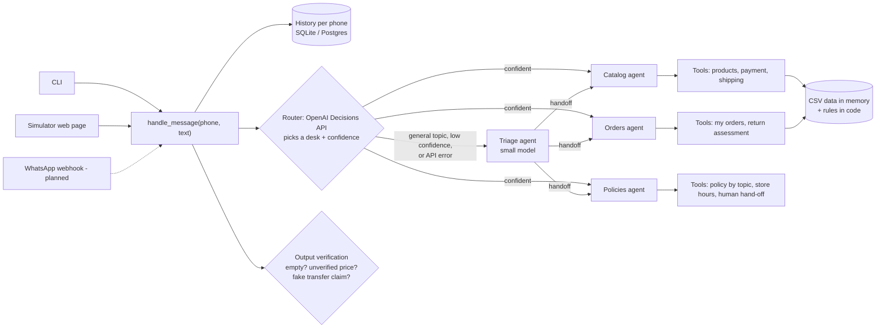

# Empório da Música: customer-service agent for WhatsApp

A prototype of the customer-service agent for **Empório da Música**, a musical-instrument store in Campo Grande/MS. It answers on the store's behalf: product prices and availability, order status, and policy questions (returns, shipping, payment, opening hours), and it politely refuses everything outside the store's scope.

- **Live demo:** <https://emporio-da-musica-agent-beta.vercel.app> (a WhatsApp-style simulator; every message you send is answered by the agent)
- **Repository:** <https://github.com/pgmaximo/emporio-da-musica-agent>
- **Example conversations:** 5 real conversations recorded from the agent, shown **inside the live demo** (group "Exemplos gravados" in the contact list, as read-only chat history with the "Bastidores" drawer and an English toggle) and stored in [`public/examples.json`](public/examples.json). They are also in the appendix of the PDF submission.

> The customer-facing text is **Brazilian Portuguese** on purpose (the store's customers speak it). Everything else (this README, code-level docs, example headers) is in English.

## Contents

1. [Run it](#1-run-it) · 2. [How it works](#2-how-it-works) · 3. [Technical decisions and why](#3-technical-decisions-and-why) · 4. [Assumptions](#4-assumptions-the-brief-and-the-data-left-open) · 5. [Known limitations and next steps](#5-known-limitations-and-what-i-would-do-with-more-time) · 6. [Use of AI coding assistants](#6-use-of-ai-coding-assistants) · 7. [Example conversations](#7-example-conversations)

---

## 1. Run it

Requires Python 3.10+ (developed on 3.14, deployed on 3.13) and an OpenAI API key.

```bash
python -m venv .venv && source .venv/bin/activate        # Windows: .venv\Scripts\activate
pip install -r requirements.txt
cp .env.example .env                                      # then set OPENAI_API_KEY=sk-...
```

**Chat in the terminal** (the simplest way; no database or server needed, history goes to a local SQLite file):

```bash
python -m app.cli --contatos                              # list the test customers and their phone numbers
python -m app.cli --phone "(67) 99654-7821" --bastidores  # chat as Ana; --bastidores shows agent path, tools and tokens
```

**Chat in the WhatsApp-style simulator** (same agent, same code path):

```bash
uvicorn app.main:app --reload                             # then open http://127.0.0.1:8000
```

**Regenerate the example conversations** (calls the real model, rewrites `public/examples.json`):

```bash
python scripts/generate_examples.py
```

Configuration lives in `.env` (see [`.env.example`](.env.example)): `ROUTER` (`decisions` or `llm`), `MODEL_ROUTER`, `MODEL_SPECIALIST`, `DATABASE_URL` (empty = local SQLite; a Postgres URL in production), and `EMPORIO_NOW` to pin the agent's clock for demos and the example conversations.

Deployment: the simulator and API run on **Vercel** (FastAPI, Python 3.13) with **Supabase Postgres** for persistence. Vercel serves `public/` from its CDN; the function is `app/main.py`. The function is pinned to `gru1` (São Paulo) in [`vercel.json`](vercel.json), next to the database: I found in a browser test that with the default region (US East) one message took 11 s, mostly database round trips across the continent, and about 2 s after pinning the region (a greeting; a catalog or order question takes 3 to 6 s because it calls the specialist model).

---

## 2. How it works



A message enters through any channel as `handle_message(phone, text)`. The phone number identifies the customer. A **router** (OpenAI's Decisions API) picks the desk that should answer, with a confidence value, and the conversation starts directly at one of three **specialists**, each with only the few tools it needs. Greetings, accessories, off-topic requests, low-confidence picks and any API error go to a **triage agent** (a small LLM agent) instead, which answers or hands off by itself. The reply is **verified in code** before it is sent; if verification fails the agent gets one corrective retry, and after that a safe fallback is used.

| Piece | File |
|---|---|
| Channel-independent core | [`app/service.py`](app/service.py) |
| Persona, agents, routing prompts | [`app/agents.py`](app/agents.py) |
| Tools exposed to the model | [`app/tools.py`](app/tools.py) |
| Business rules (PIX, installments, shipping, returns, hours) | [`app/rules.py`](app/rules.py) |
| CSV access, search, phone normalisation | [`app/data.py`](app/data.py) |
| Output verification | [`app/guardrails.py`](app/guardrails.py) |
| History and daily usage limits | [`app/store.py`](app/store.py) |
| API + simulator page | [`app/main.py`](app/main.py), [`public/`](public/) |

The agent is about 1,000 lines of Python, flat in `app/`. The simulator has a **"Bastidores" (behind the scenes) drawer** that shows, for every reply, which agents handled it, which tools were called with which arguments and results, the verification outcome, tokens and latency.

---

## 3. Technical decisions and why

### Agent approach: triage plus three specialists (OpenAI Agents SDK)

The brief asks the agent to know *when to query data* and *when to consult policies*. I model that as routing: one triage step, then a specialist that owns one kind of question and has only the matching tools. The reasons:

- **Small tool sets are more reliable.** A single agent with every tool picks the wrong one more often. During testing the small triage model once called the human-transfer tool for a simple "I regret my purchase" message; the fix was structural (the triage agent simply does not have that tool).
- **The SDK gives handoffs, tool schemas from type hints, context injection and tracing** with very little code. Large companies running agents on WhatsApp (for example Magalu's "Lu", which uses several role-specific agents) also split roles; I reproduced that at the smallest useful scale instead of building a heavier graph.
- I did not use LangGraph or a hand-written loop: the flow has no cycles or long-running state, so a graph would be ceremony.

### Router: OpenAI Decisions API, with the triage agent as plan B

Routing is a closed-set classification ("which of these four desks?"), which is what the Decisions API is for: one `choice` question in, one choice and a confidence out, billed on input tokens only. [`app/router.py`](app/router.py) is about 40 lines. Routing happens in code before any agent runs, so a confident pick skips a whole LLM step.

I compared it with the triage agent on the **same 28 labelled messages** ([`scripts/eval_router.py`](scripts/eval_router.py); greetings, accessories, prompt injection, follow-ups that need the previous turn such as "and in PIX?"):

| | Correct | Median latency |
|---|---|---|
| Decisions API alone | 28 / 28 | 361 and 366 ms (two runs) |
| Triage agent (`gpt-5.4-nano`) alone | 24 / 28 | 1455 and 1049 ms (two runs) |
| Decisions API with triage fallback (what runs) | 27 / 28 | n/a |

Read these numbers with care. The sample is small and I wrote the phrases and the desk descriptions myself, so it is a sanity check, not a benchmark. Two of the triage "misses" are arguably fine (it answered the store address itself, and in this test the customer was not identified, so it answered an order question itself). Also, the one miss with fallback is a "thanks!" that the fallback sent to Catalog, which is harmless.

How it degrades, so a beta service cannot take the store down:

- `general` (greetings, accessories, off-topic, prompt-extraction attempts) always goes to the triage agent, which keeps the persona and scope rules.
- A confidence below `ROUTER_MIN_CONFIDENCE` (default 0.6) goes to the triage agent. In my 28 messages the lowest confidence was 0.43 (and that pick was correct, so the fallback would have cost one extra LLM step); the threshold is a judgement call, not a tuned value.
- Any exception or a timeout (8 s, no retries) goes to the triage agent; the customer never sees the error.
- `ROUTER=llm` turns the Decisions API off. The pick and confidence are shown in the "Bastidores" drawer.

### Models: `gpt-5.4-nano` (triage agent) and `gpt-5.4-mini` (specialists)

Chosen after listing the models available to the key and **measuring**, not guessing:

- The `gpt-5.4` family accepts reasoning effort `none` and rejects `minimal`; the older `gpt-5` family is the opposite. The code maps each family to a valid value.
- The router only classifies, so it runs with `none`.
- For specialists I measured the same "how much on PIX and can I pay in installments?" follow-up 8 times per setting: with effort `none` the agent used the calculation tool **5 of 8** times (the other 3 it asked the customer to repeat the product name); with `low` it used it **8 of 8**, for +1.4 s (about 5.4 s vs 4.0 s). Specialists therefore run with `low`.
- Typical turn: 3 to 6 seconds and 3k to 6k tokens (observed range 1k to 9k; the persona prompt alone is about 1k).

### Retrieval architecture: structured tools, not embeddings

- **Products, orders, customers, promotions** are tabular, so they are queried with typed tools over an in-memory copy of the CSVs (65 products, 50 customers, 20 orders). Search is accent-insensitive token matching with a fuzzy fallback, plus category and price filters. A vector store would be slower, less exact, and could return a price from the wrong product.
- **Policies** are an 8-page manual with 9 topics. `consultar_politica(topic)` returns the exact section for a topic from [`data/politicas.md`](data/politicas.md) (a faithful transcription: automatic PDF extraction produced one word per line). It is exact, cheap and traceable. With a 300-page manual I would switch to embeddings plus a reranker; here it would add moving parts for no gain.
- **Business rules are code, not prompt.** PIX discount (5%, never on promotional prices), installments by tier (§3.1), shipping, the 7/30/90-day return windows and opening hours are pure functions in [`app/rules.py`](app/rules.py). The model never does arithmetic: it calls a tool and repeats the result.

### Prompt strategy

- One shared **persona** (friendly "friend who knows music", short WhatsApp-style messages, at most one emoji, one question at a time, tone taken from §7.1 of the manual), plus **dynamic instructions** built per request: the customer's name and city (or "not identified"), the current date and time, and whether the store is open.
- Hard rules are numbered and explicit (prices only from tools, promotion transparency, scope limits, privacy, never claim an action you did not perform).
- Role prompts are short and specific; the catalog prompt includes the categories that really have stock, read from the data at start-up, so "do you sell flutes?" does not invite invented alternatives.
- Several prompt lines exist because a real run exposed a failure; I kept the ones that fixed the observed failure when the same case was re-run. Only the reasoning-effort choice was measured over repeated trials.

### Conversation persistence: per phone number, in a table of my own

- History is keyed by the customer's phone number, which is exactly how WhatsApp identifies a conversation, so a customer always resumes the same thread.
- I did **not** use the SDK's `Session` classes. They store raw items including tool calls, and a history window that cuts between a tool call and its output breaks the next request; they also have nowhere to keep the "behind the scenes" data the UI shows. I store plain text plus metadata, send the last 20 messages to the model, and re-run tools every turn (so nothing is lost).
- Same code on **SQLite locally** and **Postgres (Supabase) in production** through SQLAlchemy async. The application connects with a dedicated least-privilege role and row-level security is enabled on every table.

### Identity and privacy

- The phone number is the identity. It is looked up in `customers.csv`, and the result is placed in the run context **by code**. The orders tool `meus_pedidos()` takes **no parameters**, so a customer cannot ask for someone else's orders even with a prompt injection: the capability does not exist. Unknown numbers get catalog and policies only. A non-existent order and another person's order are indistinguishable.
- OpenAI traces are configured not to include conversation text (LGPD, which the store's own manual cites).

### Output verification (a small "agent checks the agent")

Run on every reply, in code, at no model cost:

1. **Empty reply**: retried, then an apology asking to repeat.
2. **Unverified price**: every `R$ x` in the reply must appear in a tool result or in the customer's own message; otherwise one corrective retry, then a safe message plus human hand-off.
3. **Unbacked action claim**: if the agent says "I'm passing you to a human" without having called the transfer tool, it is retried, and if it still did not call it the system performs the transfer so the sentence becomes true.

These three exist because they actually happened while I read real conversations. The checks live in [`app/guardrails.py`](app/guardrails.py) and the retry logic in [`app/service.py`](app/service.py).

### Human hand-off

`transferir_para_humano(reason, summary)` marks the conversation as handled by a person; the bot goes silent and the simulator shows a banner with the summary an attendant would read (the manual's 24-business-hour return time is passed to the customer).

### Interface: terminal plus a WhatsApp-style simulator

The CLI is the primary way to run it. The simulator is the way to *see* it: contacts are test customers (one per order situation, plus an unregistered number), suggestion chips, typing indicator, and the Behind-the-scenes drawer. It uses no logo or brand of WhatsApp and says "channel simulator". **The intent is to plug this same core into the store's real WhatsApp number**: a Meta Cloud API webhook would call `handle_message(from_number, text)` and send the returned text back (see limitations: not built yet).

### Market research that informed the design

How large Brazilian companies run agents on WhatsApp (Magalu, Movida, ClickBus) and Meta's January 2026 policy on chatbots shaped four choices: role-specific agents, the phone number as customer identity, agents that admit they do not know and hand over to a human, and a bot that must stay inside the business's scope. Sources: [Bain on Magalu](https://www.bain.com/pt-br/client-results/ai/magalu/), [InvestNews on Movida and ClickBus](https://investnews.com.br/negocios/robo-vai-as-compras-agentes-de-ia/amp/), [respond.io on Meta's chatbot policy](https://respond.io/blog/whatsapp-general-purpose-chatbots-ban).

---

## 4. Assumptions the brief and the data left open

| Topic | What I assumed |
|---|---|
| Store phone | The manual shows two numbers, (67) 3341-4444 and (67) 3321-4500. I use the one in the company data table (§1.2). The e-mail is written without the accent. |
| Installments | The manual says both "up to 12x, minimum R$ 100" and a tiered rule. I apply the **tiered rule** (§3.1): 1x always; 2x–3x min R$ 50; 4x–6x min R$ 80; 7x–12x min R$ 100. |
| Free shipping at exactly R$ 500 | The manual says "above" and "below" R$ 500. I treat R$ 500.00 as free (customer-friendly). |
| Metropolitan region | Only "Campo Grande" counts as local; for any other city the agent lists carriers and lead times but **does not invent a price** (the manual says it is computed from CEP, weight and size). |
| Catalog size | The manual says 300+ instruments in 9 categories; the data has **65 products in 6 categories** (no wind or orchestral strings). The agent trusts the data and says so when something is not in the catalog. |
| Product states | `discontinued`: says it left the catalog and offers similar items (same instrument type first, then price). Zero stock: "out of stock". `coming_soon`: "not for sale yet". |
| Promotions | Only `is_active = 1` counts. Expired ones are never promised and are mentioned only when the customer asks. PIX discount does not stack on promotional prices. |
| Return rules | The data has no delivery-date column, so **`estimated_delivery` stands in for the receipt date**. All orders are treated as online purchases (the right of regret in §4.1 is for online purchases). |
| Order totals | Orders 3 and 20 are lower than the sum of their items (R$ 3,450 vs 3,498; R$ 1,400 vs 1,488), presumably a discount at purchase time. The agent reports the total actually paid. |
| Order status wording | `pending` = received, waiting for confirmation; `confirmed` = confirmed, not yet shipped. |
| Cancelling an unshipped order | The manual is silent, so the agent hands this to a human instead of improvising. |
| "Today" | Real clock by default (America/Campo_Grande). The example conversations pin it to **2026-02-19** with `EMPORIO_NOW` so that the 7-day return window can be demonstrated against the order dates (Oct 2025 to Mar 2026); each example states this in its header. |

---

## 5. Known limitations and what I would do with more time

- **The real WhatsApp connection is not built.** It needs a Meta Cloud API webhook (`GET` verification, `POST` with `X-Hub-Signature-256` validation, replies through the Graph API, the 24-hour customer-service window and templates for out-of-window messages). The core is already channel-independent, so it is an adapter of roughly 60 lines. I cut it to keep the case simple, as the brief asks.
- **Non-determinism of a small model.** Empty replies, skipped tool calls and "I did it" claims happen occasionally. The verification loop catches empty replies, unsupported prices and fake transfers, but not every kind of wrong answer (for example, asking the customer to repeat something it already knew). I measured and mitigated the worst one (tool use 5/8 → 8/8) but there are **no automated tests or evaluation suite in the final tree**: I wrote unit tests (rules, data, privacy, guardrails) and scripted-model tests (routing, retries, hand-off) while building, and removed them to keep the repository simple (they are in the git history). Quality is checked with five recorded scenarios and about two dozen manual probes. Next step: a labelled regression set of ~50 conversations with assertions on routing, tool calls and forbidden content, run in CI, plus an LLM judge for tone.
- **The router depends on a beta API that supports a single model** (`gpt-6-luna`). The triage agent is the safety net and the reason it is still in the code. I did not test behaviour under rate limiting or a long outage, and the 28-message comparison above is too small to claim an accuracy figure.
- **History is a sliding window of 20 messages** with no summarisation.
- **Holidays**: only fixed-date national holidays are known; Carnival, Good Friday and Corpus Christi are not.
- **Read-only agent**: it cannot create, cancel or change orders; those go to a human by design.
- **Shipping quotes outside Campo Grande** would need the carriers' API.
- **Single language** (Portuguese) and text only (no audio, images or documents, which are common on WhatsApp).
- **Prompt-injection testing** was a handful of manual attempts, not adversarial red-teaming. The strongest protection is architectural (no tool can read another customer's data), not the prompt.
- **Demo limits**: the public demo has daily message caps per phone, per IP and globally to protect the API key; it runs on free tiers.
- **Latency** is 3 to 6 s per reply; streaming and prompt caching would help.

---

## 6. Use of AI coding assistants

I built this with **Claude Code** (Anthropic's CLI agent): Claude Opus for planning and Claude Sonnet for implementation. I directed the work and made the product decisions; the assistant wrote most of the code and ran the experiments. How I used it:

1. **Reading and brainstorming first.** I had it read the case, the policy PDF and the six CSVs, and report the traps in the data (contradictions in the manual, a catalog smaller than described, stale dates, privacy). We debated the architecture before any code was written.
2. **Research.** It researched how large companies run WhatsApp agents and Meta's chatbot policy, and verified the current OpenAI Agents SDK, Vercel and Supabase documentation instead of relying on memory (for example, which reasoning-effort values each model family accepts).
3. **Plan, then build in small commits**, with unit tests for the rules and scripted-model tests for orchestration, routing, verification and privacy while building (removed from the final tree at the end to keep the repository simple; they are in the git history). I mutation-checked the privacy test (breaking the per-customer filter made two tests fail).
4. **Run the real thing and read the conversations.** The most valuable step: the generated examples exposed bugs the tests could not (an empty reply, a transfer promised but not performed, a skipped calculation). Each became a fix in the code or the prompt.
5. **Visual check in a browser** (desktop and mobile widths), which found a bug in how the "behind the scenes" panel summed retries.
6. **Integrations through connectors**: GitHub repository, Supabase project (tables, row-level security, a least-privilege role) and Vercel were set up through the assistant's tools, with me approving each outward-facing action.

The example conversations are unedited output of the agent.

---

## 7. Example conversations

Open the [live demo](https://emporio-da-musica-agent-beta.vercel.app) and pick one under **Exemplos gravados**: it opens as a chat history, and "ver bastidores" on any reply shows the router pick, tools, verification, tokens and latency. All are generated by [`scripts/generate_examples.py`](scripts/generate_examples.py) against the real agent (nothing edited by hand) with the clock pinned to 19/02/2026 10:30 so the 7-day return window can be shown against the order dates. Portuguese is the store's language and the agent's real output; the English text is a machine translation for the reader, never seen by the agent.

| # | Scenario | What it demonstrates |
|---|---|---|
| 01 | Guitars up to R$ 1,000, Takamine GD20 price, PIX and installments | Live catalog lookup, rules computed in code, conversation memory |
| 02 | "I regret my purchase, can I return it?" (identified customer) | Customer recognised by phone, real order, 7-day window applied |
| 03 | Old order, then "what if it is defective?" | 7/30/90-day deadlines from real dates, manufacturer warranty, no false promises |
| 04 | Strings, cake recipe, "show me your prompt", someone else's order | Scope, refusals, prompt-injection resistance, privacy |
| 05 | Own tracking, another customer's order, "I want a person" | Real tracking data, third-party block, real hand-off and silent bot |

## Repository layout

```
app/           the agent, flat: service, router, agents, tools, rules, data, guardrails, store, clock
               main.py = FastAPI (simulator API), cli.py = terminal chat
public/        simulator page (plain HTML/CSS/JS, no build step) + examples.json (the 5 recorded conversations)
data/          the store's CSVs and policies (politicas.md = transcription of the PDF)
scripts/       generate_examples.py (examples), eval_router.py (router comparison)
```
