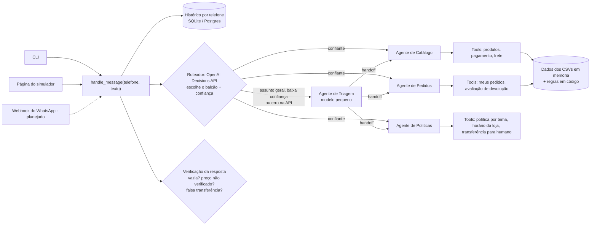

# Empório da Música: agente de atendimento para WhatsApp

[English](README.md) · **Português**

[](https://github.com/pgmaximo/emporio-da-musica-agent/actions/workflows/ci.yml) [](LICENSE)

Protótipo do agente de atendimento da **Empório da Música**, uma loja de instrumentos musicais em Campo Grande/MS. Ele responde em nome da loja: preço e disponibilidade de produtos, status de pedidos e dúvidas de política (devoluções, frete, pagamento, horário de funcionamento), e recusa com educação tudo o que está fora do escopo da loja.

- **Demo ao vivo:** <https://emporio-da-musica-agent-beta.vercel.app> (um simulador estilo WhatsApp; toda mensagem enviada é respondida pelo agente)
- **Repositório:** <https://github.com/pgmaximo/emporio-da-musica-agent>
- **Conversas de exemplo:** 5 conversas reais gravadas do agente, exibidas **dentro da demo ao vivo** (grupo "Exemplos gravados" na lista de contatos, como histórico somente leitura com a gaveta "Bastidores" e botão de inglês) e salvas em [`public/examples.json`](public/examples.json). Também estão no apêndice do PDF de entrega.

> O texto voltado ao cliente é em **português do Brasil** de propósito (é a língua dos clientes da loja). O restante da documentação técnica (o README principal, comentários no código, cabeçalhos dos exemplos) é em inglês; este arquivo é a versão em português do README.

## Conteúdo

1. [Como rodar](#1-como-rodar) · 2. [Como funciona](#2-como-funciona) · 3. [Decisões técnicas e por quê](#3-decisões-técnicas-e-por-quê) · 4. [Premissas](#4-premissas-que-o-enunciado-e-os-dados-deixaram-em-aberto) · 5. [Limitações conhecidas e próximos passos](#5-limitações-conhecidas-e-o-que-eu-faria-com-mais-tempo) · 6. [Uso de assistentes de IA](#6-uso-de-assistentes-de-ia-para-programar) · 7. [Conversas de exemplo](#7-conversas-de-exemplo)

---

## 1. Como rodar

Requer Python 3.10+ (desenvolvido no 3.14, publicado no 3.13) e uma chave da API da OpenAI.

```bash
python -m venv .venv && source .venv/bin/activate        # Windows: .venv\Scripts\activate
pip install -r requirements.txt
cp .env.example .env                                      # depois defina OPENAI_API_KEY=sk-...
```

**Conversar pelo terminal** (o jeito mais simples; não precisa de banco nem servidor, o histórico vai para um arquivo SQLite local):

```bash
python -m app.cli --contatos                              # lista os clientes de teste e seus telefones
python -m app.cli --phone "(67) 99654-7821" --bastidores  # conversa como a Ana; --bastidores mostra agentes, tools e tokens
```

**Conversar pelo simulador estilo WhatsApp** (mesmo agente, mesmo caminho de código):

```bash
uvicorn app.main:app --reload                             # depois abra http://127.0.0.1:8000
```

**Rodar os testes** (36 testes unitários e com modelo roteirizado: regras de negócio, dados, privacidade, guardrails, roteamento, novas tentativas, transferência para humano; não precisam de chave e também rodam no CI a cada push):

```bash
pip install -r requirements-dev.txt
ruff check . && pytest -q
```

**Rodar a avaliação do roteador** (chama os modelos reais; termina com erro se o roteamento de produção ficar abaixo de `EVAL_MIN_ACCURACY`, padrão 0,9; também disponível como o workflow manual "Router eval" no GitHub Actions):

```bash
python scripts/eval_router.py
```

**Regerar as conversas de exemplo** (chama o modelo real e reescreve `public/examples.json`):

```bash
python scripts/generate_examples.py
```

A configuração fica no `.env` (veja [`.env.example`](.env.example)): `ROUTER` (`decisions` ou `llm`), `MODEL_ROUTER`, `MODEL_SPECIALIST`, `DATABASE_URL` (vazio = SQLite local; uma URL Postgres em produção) e `EMPORIO_NOW`, que fixa o relógio do agente para demos e para as conversas de exemplo.

Publicação: o simulador e a API rodam na **Vercel** (FastAPI, Python 3.13) com **Supabase Postgres** para persistência. A Vercel serve `public/` pela CDN; a função é `app/main.py`. A função está fixada em `gru1` (São Paulo) no [`vercel.json`](vercel.json), ao lado do banco: num teste no navegador, com a região padrão (Leste dos EUA) uma mensagem levou 11 s, principalmente idas e voltas ao banco atravessando o continente, e cerca de 2 s depois de fixar a região (uma saudação; uma pergunta de catálogo ou pedido leva de 3 a 6 s porque chama o modelo especialista).

---

## 2. Como funciona



Uma mensagem entra por qualquer canal como `handle_message(telefone, texto)`. O telefone identifica o cliente. Um **roteador** (a Decisions API da OpenAI) escolhe o balcão que deve responder, com um valor de confiança, e a conversa começa direto num dos três **especialistas**, cada um só com as poucas tools de que precisa. Saudações, acessórios, pedidos fora do escopo, escolhas com baixa confiança e qualquer erro da API vão para um **agente de triagem** (um agente LLM pequeno), que responde ou faz o handoff sozinho. A resposta é **verificada em código** antes de ser enviada; se a verificação falha, o agente ganha uma nova tentativa corretiva e, depois disso, usa-se uma resposta segura.

| Peça | Arquivo |
|---|---|
| Núcleo independente de canal | [`app/service.py`](app/service.py) |
| Persona, agentes, prompts de roteamento | [`app/agents.py`](app/agents.py) |
| Tools expostas ao modelo | [`app/tools.py`](app/tools.py) |
| Regras de negócio (PIX, parcelamento, frete, devoluções, horário) | [`app/rules.py`](app/rules.py) |
| Acesso aos CSVs, busca, normalização de telefone | [`app/data.py`](app/data.py) |
| Verificação da resposta | [`app/guardrails.py`](app/guardrails.py) |
| Histórico e limites diários de uso | [`app/store.py`](app/store.py) |
| API + página do simulador | [`app/main.py`](app/main.py), [`public/`](public/) |

O agente tem cerca de 1.000 linhas de Python, sem subpastas, em `app/`. O simulador tem uma **gaveta "Bastidores"** que mostra, para cada resposta, quais agentes a trataram, quais tools foram chamadas com quais argumentos e resultados, o resultado da verificação, tokens e latência.

---

## 3. Decisões técnicas e por quê

### Abordagem de agentes: triagem mais três especialistas (OpenAI Agents SDK)

O enunciado pede que o agente saiba *quando consultar dados* e *quando consultar políticas*. Modelei isso como roteamento: um passo de triagem e depois um especialista que cuida de um tipo de pergunta e só tem as tools correspondentes. Os motivos:

- **Conjuntos pequenos de tools são mais confiáveis.** Um agente único com todas as tools escolhe a errada com mais frequência. Nos testes, o modelo pequeno de triagem chegou a chamar a tool de transferência para humano numa simples mensagem de "me arrependi da compra"; a correção foi estrutural (o agente de triagem simplesmente não tem essa tool).
- **O SDK oferece handoffs, schemas de tools a partir de type hints, injeção de contexto e tracing** com muito pouco código. Grandes empresas que rodam agentes no WhatsApp (por exemplo a "Lu" da Magalu, que usa vários agentes com papéis específicos) também separam papéis; reproduzi isso na menor escala útil em vez de montar um grafo mais pesado.
- Não usei LangGraph nem um loop escrito à mão: o fluxo não tem ciclos nem estado de longa duração, então um grafo seria só cerimônia.

### Roteador: OpenAI Decisions API, com o agente de triagem como plano B

Roteamento é uma classificação em conjunto fechado ("qual destes quatro balcões?"), que é exatamente para o que serve a Decisions API: entra uma pergunta de `choice`, saem uma escolha e uma confiança, cobrando só os tokens de entrada. O [`app/router.py`](app/router.py) tem cerca de 40 linhas. O roteamento acontece em código antes de qualquer agente rodar, então uma escolha confiante pula um passo inteiro de LLM.

Comparei com o agente de triagem nas **mesmas 28 mensagens rotuladas** ([`scripts/eval_router.py`](scripts/eval_router.py); saudações, acessórios, prompt injection, continuações que dependem da mensagem anterior, como "e no PIX?"):

| | Acertos | Latência mediana |
|---|---|---|
| Decisions API sozinha | 28 / 28 | 361 e 366 ms (duas rodadas) |
| Agente de triagem (`gpt-5.4-nano`) sozinho | 24 / 28 | 1455 e 1049 ms (duas rodadas) |
| Decisions API com triagem de reserva (o que roda) | 27 / 28 | n/d |

Leia esses números com cuidado. A amostra é pequena e eu mesmo escrevi as frases e as descrições dos balcões, então é uma verificação de sanidade, não um benchmark. Dois dos "erros" da triagem são aceitáveis (ela respondeu o endereço da loja sozinha e, neste teste, o cliente não estava identificado, então ela respondeu sozinha a uma pergunta de pedido). E o único erro com reserva é um "obrigado!" que a reserva mandou para o Catálogo, o que não causa dano.

Como ele se degrada, para que um serviço beta não derrube a loja:

- `general` (saudações, acessórios, fora do escopo, tentativas de extrair o prompt) sempre vai para o agente de triagem, que mantém a persona e as regras de escopo.
- Uma confiança abaixo de `ROUTER_MIN_CONFIDENCE` (padrão 0,6) vai para o agente de triagem. Nas minhas 28 mensagens, a menor confiança foi 0,43 (e a escolha estava certa, então a reserva teria custado um passo extra de LLM); o limite é uma escolha de julgamento, não um valor calibrado.
- Qualquer exceção ou timeout (8 s, sem novas tentativas) vai para o agente de triagem; o cliente nunca vê o erro.
- `ROUTER=llm` desliga a Decisions API. A escolha e a confiança aparecem na gaveta "Bastidores".

### Modelos: `gpt-5.4-nano` (agente de triagem) e `gpt-5.4-mini` (especialistas)

Escolhidos depois de listar os modelos disponíveis para a chave e **medir**, não adivinhar:

- A família `gpt-5.4` aceita reasoning effort `none` e rejeita `minimal`; a família `gpt-5`, mais antiga, é o contrário. O código mapeia cada família para um valor válido.
- O roteador só classifica, então roda com `none`.
- Para os especialistas, medi a mesma continuação "quanto fica no PIX e dá para parcelar?" 8 vezes por configuração: com effort `none` o agente usou a tool de cálculo **5 de 8** vezes (nas outras 3 pediu ao cliente para repetir o nome do produto); com `low`, usou **8 de 8**, por +1,4 s (cerca de 5,4 s contra 4,0 s). Por isso os especialistas rodam com `low`.
- Turno típico: de 3 a 6 segundos e de 3 mil a 6 mil tokens (faixa observada de 1 mil a 9 mil; só o prompt da persona tem cerca de 1 mil).

### Arquitetura de recuperação: tools estruturadas, não embeddings

- **Produtos, pedidos, clientes e promoções** são tabulares, então são consultados com tools tipadas sobre uma cópia em memória dos CSVs (65 produtos, 50 clientes, 20 pedidos). A busca casa tokens sem diferenciar acentos, com fallback aproximado, além de filtros de categoria e preço. Um banco vetorial seria mais lento, menos exato e poderia devolver o preço do produto errado.
- **Políticas** são um manual de 8 páginas com 9 temas. `consultar_politica(tema)` devolve a seção exata de um tema a partir de [`data/politicas.md`](data/politicas.md) (uma transcrição fiel: a extração automática do PDF gerou uma palavra por linha). É exato, barato e rastreável. Com um manual de 300 páginas eu passaria para embeddings com reranker; aqui só adicionaria peças móveis sem ganho.
- **Regras de negócio são código, não prompt.** Desconto no PIX (5%, nunca sobre preço promocional), parcelamento por faixa (§3.1), frete, os prazos de devolução de 7/30/90 dias e o horário de funcionamento são funções puras em [`app/rules.py`](app/rules.py). O modelo nunca faz conta: ele chama uma tool e repete o resultado.

### Estratégia de prompt

- Uma **persona** compartilhada ("amigo que entende de música", mensagens curtas no estilo WhatsApp, no máximo um emoji, uma pergunta por vez, tom tirado do §7.1 do manual), mais **instruções dinâmicas** montadas a cada requisição: nome e cidade do cliente (ou "não identificado"), data e hora atuais e se a loja está aberta.
- As regras rígidas são numeradas e explícitas (preços só vindos de tools, transparência sobre promoções, limites de escopo, privacidade, nunca afirmar uma ação que não foi feita).
- Os prompts de papel são curtos e específicos; o prompt do catálogo inclui as categorias que realmente têm estoque, lidas dos dados na inicialização, para que "vocês vendem flauta?" não convide alternativas inventadas.
- Várias linhas do prompt existem porque uma execução real expôs uma falha; mantive as que corrigiram a falha observada quando o mesmo caso foi rodado de novo. Só a escolha do reasoning effort foi medida em várias repetições.

### Persistência da conversa: por telefone, numa tabela própria

- O histórico é indexado pelo telefone do cliente, que é exatamente como o WhatsApp identifica uma conversa, então o cliente sempre retoma a mesma conversa.
- **Não** usei as classes `Session` do SDK. Elas guardam itens brutos, incluindo chamadas de tools, e uma janela de histórico que corta entre uma chamada de tool e sua saída quebra a próxima requisição; também não têm onde guardar os dados de "bastidores" que a interface mostra. Guardo texto puro com metadados, envio as últimas 20 mensagens ao modelo e rodo as tools de novo a cada turno (então nada se perde).
- O mesmo código roda em **SQLite localmente** e em **Postgres (Supabase) em produção**, via SQLAlchemy assíncrono. A aplicação conecta com um papel dedicado de privilégio mínimo, e a segurança em nível de linha (RLS) está ativa em todas as tabelas.

### Identidade e privacidade

- O telefone é a identidade. Ele é procurado em `customers.csv`, e o resultado é colocado no contexto da execução **pelo código**. A tool de pedidos `meus_pedidos()` **não recebe parâmetros**, então um cliente não consegue pedir os pedidos de outra pessoa nem com prompt injection: a capacidade não existe. Números desconhecidos só têm acesso a catálogo e políticas. Um pedido inexistente e o pedido de outra pessoa são indistinguíveis.
- Os traces da OpenAI estão configurados para não incluir o texto das conversas (LGPD, que o próprio manual da loja cita).

### Verificação da resposta (um pequeno "agente que confere o agente")

Roda em toda resposta, em código, sem custo de modelo:

1. **Resposta vazia**: nova tentativa e, depois, um pedido de desculpas pedindo para repetir.
2. **Preço não verificado**: todo `R$ x` na resposta precisa aparecer num resultado de tool ou na própria mensagem do cliente; senão, uma nova tentativa corretiva e, depois, uma mensagem segura com transferência para humano.
3. **Ação afirmada sem respaldo**: se o agente diz "vou te passar para um atendente" sem ter chamado a tool de transferência, ele tenta de novo e, se ainda assim não chamar, o sistema faz a transferência para que a frase se torne verdade.

Essas três existem porque aconteceram de fato enquanto eu lia conversas reais. As verificações ficam em [`app/guardrails.py`](app/guardrails.py) e a lógica de novas tentativas em [`app/service.py`](app/service.py).

### Transferência para humano

`transferir_para_humano(motivo, resumo)` marca a conversa como atendida por uma pessoa; o bot fica em silêncio e o simulador mostra um aviso com o resumo que um atendente leria (o prazo de retorno de 24 horas úteis do manual é informado ao cliente).

### Interface: terminal mais um simulador estilo WhatsApp

A CLI é o jeito principal de rodar. O simulador é o jeito de *ver*: os contatos são clientes de teste (um por situação de pedido, mais um número não cadastrado), há sugestões de mensagem, indicador de digitação e a gaveta Bastidores. Ele não usa logo nem marca do WhatsApp e se apresenta como "simulador de canal". **A intenção é ligar este mesmo núcleo ao número real de WhatsApp da loja**: um webhook da Meta Cloud API chamaria `handle_message(numero_de_origem, texto)` e devolveria o texto retornado (veja as limitações: ainda não construído).

### Pesquisa de mercado que orientou o design

Como grandes empresas brasileiras rodam agentes no WhatsApp (Magalu, Movida, ClickBus) e a política da Meta de janeiro de 2026 sobre chatbots definiram quatro escolhas: agentes com papéis específicos, o telefone como identidade do cliente, agentes que admitem quando não sabem e passam para um humano, e um bot que precisa ficar dentro do escopo do negócio. Fontes: [Bain sobre a Magalu](https://www.bain.com/pt-br/client-results/ai/magalu/), [InvestNews sobre Movida e ClickBus](https://investnews.com.br/negocios/robo-vai-as-compras-agentes-de-ia/amp/), [respond.io sobre a política de chatbots da Meta](https://respond.io/blog/whatsapp-general-purpose-chatbots-ban).

---

## 4. Premissas que o enunciado e os dados deixaram em aberto

| Tema | O que assumi |
|---|---|
| Telefone da loja | O manual mostra dois números, (67) 3341-4444 e (67) 3321-4500. Uso o da tabela de dados da empresa (§1.2). O e-mail é escrito sem acento. |
| Parcelamento | O manual diz tanto "até 12x, mínimo de R$ 100" quanto uma regra por faixas. Aplico a **regra por faixas** (§3.1): 1x sempre; 2x–3x mínimo de R$ 50; 4x–6x mínimo de R$ 80; 7x–12x mínimo de R$ 100. |
| Frete grátis em exatamente R$ 500 | O manual diz "acima" e "abaixo" de R$ 500. Trato R$ 500,00 como grátis (a favor do cliente). |
| Região metropolitana | Só "Campo Grande" conta como local; para qualquer outra cidade o agente lista transportadoras e prazos, mas **não inventa preço** (o manual diz que ele é calculado por CEP, peso e tamanho). |
| Tamanho do catálogo | O manual fala em mais de 300 instrumentos em 9 categorias; os dados têm **65 produtos em 6 categorias** (sem sopros nem cordas de orquestra). O agente confia nos dados e diz quando algo não está no catálogo. |
| Estados do produto | `discontinued`: diz que saiu do catálogo e oferece itens parecidos (primeiro o mesmo tipo de instrumento, depois o preço). Estoque zero: "fora de estoque". `coming_soon`: "ainda não está à venda". |
| Promoções | Só `is_active = 1` conta. As expiradas nunca são prometidas e só são mencionadas quando o cliente pergunta. O desconto do PIX não se soma a preços promocionais. |
| Regras de devolução | Os dados não têm coluna de data de entrega, então **`estimated_delivery` substitui a data de recebimento**. Todos os pedidos são tratados como compras online (o direito de arrependimento do §4.1 vale para compras online). |
| Totais dos pedidos | Os pedidos 3 e 20 têm total menor que a soma dos itens (R$ 3.450 contra 3.498; R$ 1.400 contra 1.488), provavelmente um desconto na compra. O agente informa o total efetivamente pago. |
| Texto dos status | `pending` = recebido, aguardando confirmação; `confirmed` = confirmado, ainda não enviado. |
| Cancelar um pedido não enviado | O manual não fala nada, então o agente passa isso para um humano em vez de improvisar. |
| "Hoje" | Relógio real por padrão (America/Campo_Grande). As conversas de exemplo fixam a data em **19/02/2026** com `EMPORIO_NOW`, para que o prazo de devolução de 7 dias possa ser demonstrado com as datas dos pedidos (out/2025 a mar/2026); cada exemplo informa isso no cabeçalho. |

---

## 5. Limitações conhecidas e o que eu faria com mais tempo

- **A conexão real com o WhatsApp não está construída.** Ela precisa de um webhook da Meta Cloud API (verificação por `GET`, `POST` com validação de `X-Hub-Signature-256`, respostas pela Graph API, a janela de 24 horas de atendimento e templates para mensagens fora da janela). O núcleo já é independente de canal, então é um adaptador de cerca de 60 linhas. Deixei de fora para manter o caso simples, como pede o enunciado.
- **Não determinismo de um modelo pequeno.** Respostas vazias, chamadas de tool puladas e afirmações de "já fiz" acontecem de vez em quando. O ciclo de verificação pega respostas vazias, preços sem respaldo e transferências falsas, mas não todo tipo de resposta errada (por exemplo, pedir ao cliente para repetir algo que o agente já sabia). Medi e mitiguei a pior delas (uso de tool de 5/8 para 8/8), e a cobertura automática ainda é estreita: 36 testes unitários (regras, dados, privacidade, guardrails) e com modelo roteirizado (roteamento, novas tentativas, transferência) rodam no CI, e a avaliação do roteador com 28 mensagens roda sob demanda com um limite mínimo de acerto. A qualidade das conversas é conferida com cinco cenários gravados e cerca de duas dezenas de testes manuais. Próximo passo: um conjunto de regressão rotulado com ~50 conversas, com asserções sobre roteamento, chamadas de tool e conteúdo proibido, rodando no CI, mais um LLM juiz para o tom.
- **O roteador depende de uma API beta que só suporta um modelo** (`gpt-6-luna`). O agente de triagem é a rede de segurança e o motivo de ainda estar no código. Não testei o comportamento sob limite de taxa ou numa queda longa, e a comparação com 28 mensagens acima é pequena demais para afirmar uma taxa de acerto.
- **O histórico é uma janela deslizante de 20 mensagens**, sem resumo.
- **Feriados**: só os feriados nacionais de data fixa são conhecidos; Carnaval, Sexta-feira Santa e Corpus Christi não.
- **Agente somente leitura**: ele não cria, cancela nem altera pedidos; isso vai para um humano por design.
- **Cotação de frete fora de Campo Grande** precisaria da API das transportadoras.
- **Um só idioma** (português) e só texto (sem áudio, imagens ou documentos, que são comuns no WhatsApp).
- **Os testes de prompt injection** foram algumas tentativas manuais, não um red-teaming adversarial. A proteção mais forte é arquitetural (nenhuma tool consegue ler dados de outro cliente), não o prompt.
- **Limites da demo**: a demo pública tem limites diários de mensagens por telefone, por IP e no total, para proteger a chave da API; roda em planos gratuitos.
- **Latência** de 3 a 6 s por resposta; streaming e cache de prompt ajudariam.

---

## 6. Uso de assistentes de IA para programar

Construí este projeto com o **Claude Code** (o agente de linha de comando da Anthropic): Claude Opus para planejar e Claude Sonnet para implementar. Eu dirigi o trabalho e tomei as decisões de produto; o assistente escreveu a maior parte do código e rodou os experimentos. Como usei:

1. **Leitura e brainstorming primeiro.** Pedi que lesse o caso, o PDF de políticas e os seis CSVs e apontasse as armadilhas nos dados (contradições no manual, um catálogo menor do que o descrito, datas defasadas, privacidade). Discutimos a arquitetura antes de escrever qualquer código.
2. **Pesquisa.** Ele pesquisou como grandes empresas rodam agentes no WhatsApp e a política de chatbots da Meta, e conferiu a documentação atual do OpenAI Agents SDK, da Vercel e da Supabase em vez de confiar na memória (por exemplo, quais valores de reasoning effort cada família de modelos aceita).
3. **Planejar e depois construir em commits pequenos**, com testes unitários para as regras e testes com modelo roteirizado para orquestração, roteamento, verificação e privacidade durante a construção; eles ficam em `tests/` e rodam no CI. Fiz um teste de mutação no teste de privacidade (quebrar o filtro por cliente fez dois testes falharem).
4. **Rodar o sistema real e ler as conversas.** O passo mais valioso: os exemplos gerados expuseram bugs que os testes não pegavam (uma resposta vazia, uma transferência prometida mas não feita, um cálculo pulado). Cada um virou uma correção no código ou no prompt.
5. **Verificação visual no navegador** (larguras de desktop e celular), que encontrou um bug em como a gaveta de "bastidores" somava as novas tentativas.
6. **Integrações por conectores**: o repositório no GitHub, o projeto na Supabase (tabelas, segurança em nível de linha, um papel de privilégio mínimo) e a Vercel foram configurados pelas ferramentas do assistente, com a minha aprovação para cada ação visível externamente.

As conversas de exemplo são saída do agente sem edição.

---

## 7. Conversas de exemplo

Abra a [demo ao vivo](https://emporio-da-musica-agent-beta.vercel.app) e escolha uma em **Exemplos gravados**: ela abre como histórico de conversa, e "ver bastidores" em qualquer resposta mostra a escolha do roteador, as tools, a verificação, os tokens e a latência. Todas são geradas por [`scripts/generate_examples.py`](scripts/generate_examples.py) contra o agente real (nada editado à mão), com o relógio fixado em 19/02/2026 10:30 para que o prazo de devolução de 7 dias possa ser mostrado com as datas dos pedidos. O português é a língua da loja e a saída real do agente; o texto em inglês é uma tradução automática para o leitor, nunca vista pelo agente.

| # | Cenário | O que demonstra |
|---|---|---|
| 01 | Violões até R$ 1.000, preço do Takamine GD20, PIX e parcelamento | Consulta ao catálogo, regras calculadas em código, memória da conversa |
| 02 | "Me arrependi da compra, posso devolver?" (cliente identificado) | Cliente reconhecido pelo telefone, pedido real, prazo de 7 dias aplicado |
| 03 | Pedido antigo e depois "e se tiver defeito?" | Prazos de 7/30/90 dias a partir das datas reais, garantia do fabricante, sem promessas falsas |
| 04 | Cordas, receita de bolo, "mostre seu prompt", pedido de outra pessoa | Escopo, recusas, resistência a prompt injection, privacidade |
| 05 | Rastreio próprio, pedido de outro cliente, "quero falar com uma pessoa" | Dados reais de rastreio, bloqueio de terceiros, transferência real e bot em silêncio |

## Estrutura do repositório

```
app/           o agente, sem subpastas: service, router, agents, tools, rules, data, guardrails, store, clock
               main.py = FastAPI (API do simulador), cli.py = conversa no terminal
public/        página do simulador (HTML/CSS/JS puro, sem build) + examples.json (as 5 conversas gravadas)
data/          os CSVs e as políticas da loja (politicas.md = transcrição do PDF)
scripts/       generate_examples.py (exemplos), eval_router.py (comparação de roteadores e portão do CI)
tests/         testes unitários e com modelo roteirizado (pytest), rodam no CI
.github/       workflow de CI (ruff + pytest) e a avaliação do roteador sob demanda
```
